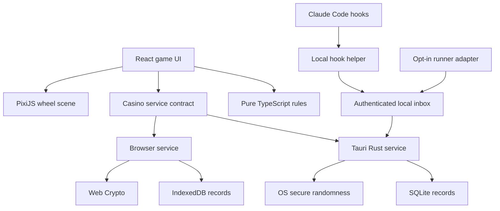
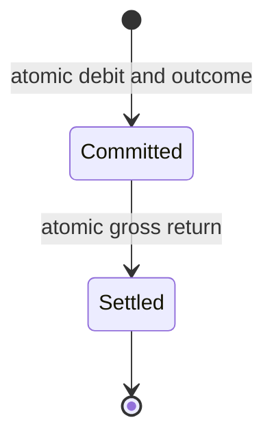

# Commit Casino Architecture

Status: implementation blueprint. This document specifies the intended product; it does not claim that the application has already been implemented.

Repository: <https://github.com/ndunl075/commit-casino>  
Primary branch: `main`  
Architecture date: October 12, 2026

## 1. Product and constraints

Commit Casino is a free, open-source roulette game for developers waiting on coding agents. It must be enjoyable as a standalone casino game, with agent integration added as an optional convenience.

Classic Roulette is the first complete gameplay mode. Agent Roulette is a later mode that lets users predict observed outcomes of a coding-agent turn. These modes share a fictional-chip wallet but have different outcome sources: secure randomness for Classic Roulette, verified local evidence for Agent Roulette.

### Non-negotiable requirements

- European roulette with one zero, accurate betting geometry, and all standard bets specified below.
- Starting balance of 10,000 fictional chips; free refills and resets.
- Chips cannot be purchased, transferred, redeemed, or exchanged for anything of monetary value.
- No payments, advertisements, prizes, crypto, accounts, subscriptions, paid APIs, or external model calls.
- No hosted backend, cloud database, or required network connection after installation.
- No telemetry by default. Diagnostics remain local unless the user explicitly exports them.
- Windows desktop first; browser Classic Roulette shares the game UI and rules. macOS and Linux follow platform validation.
- Claude Code integration is optional and passive: no prompt changes, injected instructions, automatic approvals, or agent-control commands.
- Do not read repository source, prompt text, responses, or transcripts for gameplay.
- MIT license for original code. Record third-party asset and dependency licenses separately.

### Development instruction: use Astra for UI

**Use GPT Astra for UI design and implementation**, including the roulette wheel, felt table, chip stacks, layout, animation choreography, audio presentation, and visual polish. Give Astra this document, the shared component contracts, and real screenshots from the application as it develops. Judge the result by playable interaction and recorded demonstrations.

This is a development workflow instruction. Astra is not a runtime dependency. Commit Casino must never call an AI model or require an API key to play.

### Scope boundaries

The first release includes a finished Classic Roulette game, persistence, Windows packaging, and optional Claude Code launch/status notifications. Agent Roulette is released separately only after its evidence and attribution requirements pass verification. Multiplayer, real-money features, cloud leaderboards, public profiles, arbitrary test-output parsing, and automatic task execution are outside scope.

## 2. Technology choices

| Layer | Choice | Responsibility |
| --- | --- | --- |
| Workspace | npm workspaces; committed lockfile | Shared packages, reproducible scripts |
| Application language | TypeScript, strict mode | Pure rules, view models, UI, adapters |
| UI | React with Vite | Table, controls, onboarding, history, accessibility |
| Wheel rendering | PixiJS 8 | Wheel, ball, lighting, particles |
| UI state | Zustand | Transient selections and authoritative snapshots |
| Desktop shell | Tauri 2 and Rust | Windows, native commands, secure randomness, storage, local bridge |
| Desktop storage | SQLite through Rust | Atomic wallet and round transactions, evidence, settings |
| Browser storage | IndexedDB | Equivalent transactional records for standalone Classic Roulette |
| Browser randomness | Web Crypto `getRandomValues` | Secure random bytes with rejection sampling |
| Hook helper | Small compiled Rust executable | Read hook input, sanitize, enqueue events, optionally start app |
| Runtime validation | Zod in TypeScript; typed Rust validation | Versioned message and storage contracts |
| Unit/property tests | Vitest and fast-check | Rules, reducer behavior, contract fixtures |
| UI tests | Playwright | Browser gameplay and shared component flows |
| Native tests | Rust unit/integration tests | Transactions, recovery, bridge, migrations, installation |

Pin tested dependency versions in the lockfiles. These are architecture choices, not permission to depend on undocumented interfaces or presumed future versions. Packaged users do not need Node, Rust, or developer tooling.

### Why two local storage adapters

The desktop host needs native persistence and hook ingestion; a browser-only game cannot depend on a native bridge. Keep the domain contracts identical and implement SQLite and IndexedDB adapters behind them. Do not emulate desktop integration by exposing a browser-accessible command server.

### Rules ownership

Use one versioned canonical catalog, `rules/european-v1.json`, containing wheel order, colors, every valid bet ID, coverage, and profit odds. TypeScript consumes it in the pure roulette engine; Rust embeds the same file and validates/settles accepted bets from it. A generated fixture suite must confirm both implementations agree.

Rust is the desktop financial-state authority. The UI cannot specify its own odds, coverage, winnings, or outcome. The catalog is immutable per rules version; retain old versions needed to settle or display existing rounds.

## 3. System boundaries



The UI issues typed intents and renders service snapshots. It does not mutate wallet records. PixiJS receives a committed presentation plan and cannot place bets, choose outcomes, or award chips. Agent adapters emit observations; they cannot settle a Classic Roulette round or access its random generator.

### Package responsibilities

| Package | Owns | Must not own |
| --- | --- | --- |
| `roulette-engine` | Catalog validation, bet coverage, payout calculations, pure draft operations | UI, filesystem, RNG implementation, persistence |
| `game-ui` | React table, controls, HUD, accessibility, Pixi scene, audio | Authoritative balances or settlement |
| `casino-contracts` | DTOs, schema versions, error codes, service port | Platform-specific implementation |
| `browser-runtime` | Web Crypto, IndexedDB, browser command orchestration | Hooks, native windows, filesystem access |
| `agent-adapters` | Claude hook mapping and versioned compatibility fixtures | Fabricated success inference or permission decisions |
| `agent-roulette` | Pure classifier, evidence policy, fixed payout catalog | RNG-based agent outcomes or autonomous tests |
| `storage-contracts` | Record schemas, migration fixtures, export formats | Direct UI writes to databases |
| Desktop Rust modules | Command authority, SQLite, window policy, inbox consumer, RNG | Parsing free-form agent conclusions |

## 4. Proposed repository layout

```text
commit-casino/
  ARCHITECTURE.md
  README.md
  LICENSE
  CONTRIBUTING.md
  THIRD_PARTY_NOTICES.md
  package.json
  package-lock.json
  rules/
    european-v1.json
    agent-v1.json
  apps/
    desktop/
      src/
        app.tsx
        platform.ts
      src-tauri/
        capabilities/
        migrations/
        src/
          commands.rs
          round_service.rs
          wallet.rs
          catalog.rs
          randomness.rs
          storage.rs
          inbox.rs
          sessions.rs
          windows.rs
        tauri.conf.json
        Cargo.toml
        Cargo.lock
    web/
      src/
        app.tsx
        platform.ts
        service-worker.ts
  crates/
    hook-bridge/
      src/
        main.rs
        sanitizer.rs
        spool.rs
        installer.rs
        verifier.rs
  packages/
    roulette-engine/src/
    game-ui/src/
      components/
      table/
      wheel/
      animation/
      audio/
      accessibility/
    casino-contracts/src/
    browser-runtime/src/
    agent-adapters/src/claude/
    agent-roulette/src/
    storage-contracts/src/
  assets/
    textures/
    sounds/
    fonts/
    licenses/
  scripts/
  tests/
    fixtures/
    contracts/
    recovery/
    e2e/
  .github/workflows/
```

This is the target structure to create during implementation. Avoid introducing empty Codex adapters or packages with no responsibility. Add provider support when documented capabilities and fixture coverage exist.

## 5. Classic Roulette rules

### Wheel and colors

There are exactly 37 pockets. Use this clockwise order as viewed from above, with the renderer's origin at the center of zero:

```text
0, 32, 15, 19, 4, 21, 2, 25, 17, 34, 6, 27, 13, 36, 11, 30, 8,
23, 10, 5, 24, 16, 33, 1, 20, 14, 31, 9, 22, 18, 29, 7, 28, 12,
35, 3, 26
```

Red numbers: `1, 3, 5, 7, 9, 12, 14, 16, 18, 19, 21, 23, 25, 27, 30, 32, 34, 36`. Black numbers are the remaining nonzero numbers. Zero is green. Never derive colors from parity or wheel index.

### Bet catalog

| Bet | Valid coverage | Profit odds | Gross return multiplier |
| --- | --- | ---: | ---: |
| Straight | Any one pocket including 0 | 35:1 | 36 |
| Split | Two edge-adjacent table numbers; also 0–1, 0–2, 0–3 | 17:1 | 18 |
| Street | Each row of three: 1–3, 4–6, …, 34–36 | 11:1 | 12 |
| Zero trio | 0–1–2 or 0–2–3 | 11:1 | 12 |
| Corner | Four numbers meeting at a grid intersection | 8:1 | 9 |
| First four | 0–1–2–3 | 8:1 | 9 |
| Six line | Two adjacent streets | 5:1 | 6 |
| Dozen | 1–12, 13–24, or 25–36 | 2:1 | 3 |
| Column | One of the three table columns, excluding zero | 2:1 | 3 |
| Red / Black | Corresponding 18 nonzero pockets | 1:1 | 2 |
| Odd / Even | Corresponding 18 nonzero pockets | 1:1 | 2 |
| Low / High | 1–18 or 19–36 | 1:1 | 2 |

The zero trio and first-four bets complete the zero-end table geometry. There is no double zero, American five-number bet, en prison, or la partage. Zero loses on every outside bet.

Canonical IDs must identify valid catalog entries, for example `straight:7`, `split:1-4`, `corner:1-2-4-5`, and `outside:red`. Accept IDs and integer stakes; reject arbitrary coverage arrays submitted by clients. Sort number lists numerically when generating IDs. The catalog must contain 37 straights, 60 splits, 12 streets, 2 zero trios, 22 ordinary corners, 1 first-four, 11 six lines, 3 dozens, 3 columns, and 6 even-money bets: 157 entries total.

### Settlement mathematics

For stake `s` and profit odds `p`, a winning bet returns `s × (p + 1)` and a losing bet returns zero. Deduct stakes once when a round commits, then credit gross returns once when it settles.

```text
roundStake = sum(bet.stake)
grossReturn = sum(winningBet.stake × (winningBet.profitOdds + 1))
netChange = grossReturn - roundStake
balanceAfterSettlement = balanceBeforeCommit - roundStake + grossReturn
```

Example: 100 on 7 and 50 on red, result 7. Stake is 150; gross return is `3,600 + 100 = 3,700`; net change is `+3,550`. A 10,000 balance ends at 13,550. Result 0 loses both bets, ending at 9,850.

Track gross returns and net change separately. Do not label returned stakes as profit. Potential returns depend on the outcome: show each bet's winning gross return and the draft's maximum return across the 37 outcomes, rather than summing incompatible winning scenarios.

### Draft controls

- Chip denominations: 10, 50, 100, 500, 1,000. Stakes are positive integer multiples of 10.
- Placement adds one selected denomination to a catalog location. Preserve an operation stack for Undo, while aggregating stakes by bet ID for settlement.
- Undo reverses the most recent draft operation, including a composite Double or Rebet operation.
- Clear empties the draft without changing the persisted wallet.
- Rebet replaces the draft with the last committed Classic round's bet set, after confirmation if a nonempty draft would be replaced. It never starts a spin.
- Double multiplies the entire draft by two atomically. Reject the whole operation if funds or safe-integer bounds would be exceeded.
- Spin requires a nonempty affordable draft. Lock table editing while commit is pending or a Classic round is active.
- Draft affordability is advisory until the authority rechecks the wallet revision at commit. A concurrent Agent wager may change available funds.
- After settlement the round's bets remain visible as a result overlay; the next editable draft starts empty unless the user chooses Rebet.
- A fast repeat flow may combine Rebet and Spin through an explicit click, but never auto-spin continuously.

## 6. Commands, snapshots, and authority

```typescript
type Chips = number; // safe nonnegative integer, never a floating-point currency

interface BetInput {
  betId: string;
  stake: Chips;
}

interface CommitClassicRequest {
  requestId: string; // UUID generated once and reused for retries
  expectedWalletRevision: number;
  rulesVersion: "european-v1";
  bets: readonly BetInput[];
  animationMode: "normal" | "fast" | "reduced-motion";
}

interface RoundPresentation {
  roundId: string;
  outcome: number;
  pocketIndex: number;
  animationSeed: number; // cosmetic only; never selects the outcome
  durationMs: number;
  committedAt: string;
  presentationState: "pending" | "shown";
}

interface CasinoService {
  getSnapshot(): Promise<CasinoSnapshot>;
  commitClassic(request: CommitClassicRequest): Promise<CommittedRound>;
  acknowledgePresentation(roundId: string): Promise<void>;
  resetWallet(requestId: string): Promise<CasinoSnapshot>;
  refillWallet(requestId: string): Promise<CasinoSnapshot>;
  updateSettings(patch: SettingsPatch): Promise<CasinoSnapshot>;
  subscribe(listener: (snapshot: CasinoSnapshot) => void): () => void;
}
```

The illustrative types become complete DTO schemas in `casino-contracts`. Agent-mode commands are added when that feature is enabled. Snapshots include a monotonic revision, wallet balance, outstanding stakes, active Classic round, sessions, settings, and feature availability. Discard stale event snapshots and refetch after a reconnect or revision gap.

Commands return structured errors: `INSUFFICIENT_FUNDS`, `STALE_REVISION`, `ROUND_ACTIVE`, `INVALID_BET`, `OVERFLOW`, `STORAGE_UNAVAILABLE`, `RNG_UNAVAILABLE`, `INTEGRATION_UNAVAILABLE`, and `VERSION_MISMATCH`. On a lost response, retry the same request ID or query its result; do not generate a new request automatically.

All chip values exposed to TypeScript remain within `Number.MAX_SAFE_INTEGER`. Rust uses checked integer arithmetic. Before accepting new obligations, validate the maximum possible balance including outstanding Classic and Agent gross returns. Reject unsafe stakes before debit; never clamp a winning payout. Drafts and UI animations are not ledger entries.

### State machines

Persisted Classic financial state is intentionally small:



The frontend has a separate presentation lifecycle: `betting → committing → spinning → revealing → result → betting`. Animation completion cannot award chips. Closing the application, skipping motion, or hiding the window cannot change the selected result.

### Commit transaction

1. Serialize native mutations through one service writer; use `BEGIN IMMEDIATE` for SQLite writes.
2. Return the previously recorded result if `requestId` already exists; reject reuse with different payloads.
3. Check rules version, canonical bet IDs, stake increments, expected revision, affordability, arithmetic bounds, and absence of another active Classic round.
4. Draw one outcome with the secure RNG. Compute and validate all payout details from the embedded catalog.
5. Insert the immutable round, bet snapshot, stake-debit ledger entry, command result, and animation plan; update wallet balance/revision in the same transaction.
6. Commit successfully before returning a presentation plan. If any step fails, no stake is debited and no spin is shown.

The random draw happens after bet validation, with no dependence on stake sizes, previous rounds, agent events, or balance. A failed database transaction may discard its unshown draw. Retrying an already committed request must reuse its stored outcome.

### Settlement and crash recovery

The native service schedules settlement at the plan's presentation deadline independently of rendering. `settle(roundId)` atomically checks status, inserts a uniquely keyed return ledger entry, updates wallet/statistics, and marks the round settled. Duplicate timers, events, or retries return the same result without new credit.

At startup, settle all committed unresolved Classic rounds from their recorded outcomes. If a round settled before its result was displayed, show the stored result once and mark presentation acknowledged. Recovery may skip the old animation. A crash before commit leaves no round; a crash after commit cannot reroll it.

Native timers use a monotonic clock during a running process. A persisted wall-clock deadline is only a recovery hint; moving the system clock cannot affect winnings. Browser service recovery runs when the page next opens or becomes active; it does not require a service worker timer to stay alive.

## 7. Secure randomness

Desktop: request random bytes from the OS through a maintained Rust secure-random API. Browser: use `crypto.getRandomValues`. Entropy failure stops round creation with a recoverable error. Never fall back to `Math.random`, a seeded gameplay PRNG, time, repository hashes, or agent activity.

Map an unsigned 32-bit sample to 37 values by rejection sampling:

```typescript
function uniformPocket(randomUint32: () => number): number {
  const range = 2 ** 32;
  const limit = Math.floor(range / 37) * 37;
  let sample: number;
  do {
    sample = randomUint32();
  } while (sample >= limit);
  return sample % 37;
}
```

This avoids modulo bias. `randomUint32` must return an unsigned integer in `[0, 2^32)`. Test rejection boundaries explicitly in both languages. Test-only RNG injection exists only in harnesses, never as a production IPC command or URL parameter.

Generate the animation seed independently after selecting the pocket. The renderer may use a seeded PRNG for bounce offsets and cosmetic variations. This seed cannot choose or alter outcomes. Statistical simulations are supplemental diagnostics, not proof of randomness and not flaky release gates.

## 8. Wheel, table, audio, and accessibility

### Wheel presentation

Use one Pixi application per game view, created outside React render cycles and destroyed cleanly on unmount. React sends plans and settings through a narrow scene controller. Do not rebuild textures, text objects, or wheel graphics every frame.

Divide a normal 5–8 second spin into launch, orbit, deceleration, rim drop, bounce, and settle. Fast mode targets roughly two seconds; reduced motion uses a short reveal. Precompute the final pocket and ball landing angle from the committed result.

Let `Δ = 2π / 37`, `i` be the pocket index, and `θw` the final wheel rotation. With zero centered at angle zero in wheel-local coordinates, the final ball angle is `θw + i × Δ`, modulo `2π`. Keep coordinate direction and the pocket-label origin consistent in every rendering path. Test all 37 landing positions.

Animate wheel and ball in opposite directions with easing and constrained bounce segments, ending at the same target transform. Use elapsed monotonic time rather than counting frames or relying on clamped ticker deltas. On visibility return, recompute the current pose; if the deadline passed, reveal the recorded result. Native settlement may have already completed.

The wheel's physical motion is a visual reconstruction, not an outcome-producing simulation. Browser and desktop plans use the same pocket geometry. Avoid heavy physics and large particle fields.

### Table and hit testing

Render the felt and betting grid with SVG/HTML so every bet position has a semantic, keyboard-accessible target. Use the conventional 12-row, three-column number grid plus zero, columns, dozens, and even-money areas. The visual orientation may rotate for wide windows, while catalog IDs remain identical.

Generate number cells, edges, intersections, street rails, and six-line rails from the same geometry model. Resolve overlapping targets with explicit priority and non-overlapping hit zones: corner/trio intersections, split edges, then cell interiors. Enlarge invisible edge targets within reasonable bounds and show a hover/focus preview listing covered numbers and odds before placement.

At compact sizes, expose a clear expanded-table action rather than squeezing intersections into unusable pixels. Provide a keyboard bet picker as an accessible alternative while keeping direct placement the primary interaction. Disable controls with a visible reason when a round locks.

### Art direction and layout

Use dark green felt, charcoal surroundings, warm brass details, rich red and black pockets, textured chip stacks, crisp typography, and restrained lighting. Starting design tokens: background `#111615`, panel `#1B2421`, felt `#123E2D`, brass `#C3A366`, red `#B93235`, pocket black `#171A19`, text `#F1EEE6`, muted text `#B5BDB7`. Validate contrast before finalizing them.

The main view contains a compact title/session bar, wheel, result strip, table, chip rack, wallet display, and action bar. Statistics/settings live in secondary views. Avoid oversized dashboard cards, gratuitous gradients, excessive rounding, emoji artwork, and fake financial graphs. Typography and assets are bundled locally with license notices.

Target window presets: compact around 680 × 760 logical pixels, standard around 1080 × 760, and fullscreen. Treat these as starting points and adjust through play testing. On small displays, permit table scrolling or a wheel/table switch instead of reducing essential bet targets below usable sizes.

### Audio and accessibility

- Separate mute, master volume, and agent-notification sound controls.
- Bundle short original or permissively licensed sounds; reuse decoded buffers.
- Trigger spin/bounce/result audio from the plan timeline, and suppress stale effects after resume.
- Honor reduced-motion preferences and offer an explicit in-game setting.
- Announce result number, color, gross return, and net change in a live region.
- Show numbers/text and focus outlines so information does not depend on color alone.
- Use semantic buttons, visible labels, logical tab order, and Escape to dismiss overlays.
- Keyboard shortcuts never register globally or intercept IDE input.
- Agent notifications do not interrupt a spin, change a bet, or capture keyboard focus.

## 9. Storage and wallet model

SQLite lives in the platform's per-user app-data directory. Use foreign keys, WAL mode, a bounded busy timeout, explicit migrations, and durable transaction settings for wallet writes. The game must remain responsive while reads/export work happen off the UI thread.

| Table / record | Important fields and constraints |
| --- | --- |
| `wallet` | Singleton ID, balance, revision, epoch; nonnegative safe integer |
| `commands` | Unique request ID, request hash, command kind, recorded result |
| `rounds` | UUID, mode, rules/payout versions, outcome, stake, gross return, status, presentation state, timestamps |
| `round_bets` | Round ID, canonical bet ID, stake, coverage/odds snapshot |
| `wallet_ledger` | ID, wallet epoch, round/wager ID, entry kind, signed delta, timestamp; unique settlement keys |
| `agent_wagers` | Session/turn, selection, stake, payout version, locked status, resolved/void reason |
| `sessions` | Provider, installation ID, session key, state, current turn, last event |
| `turns` | Turn ID, sequence, status, evidence boundary, classifier version, final category |
| `agent_events` | Unique event ID, session/turn, source sequence, normalized type, minimal safe payload |
| `verification_runs` | Unique run ID, session/turn/suite, start/end, validated counts, exit code, integrity status |
| `settings` | Versioned settings JSON, window geometry, integration preferences |
| `achievements` | Achievement key, unlock timestamp, source record |

Maintain checks and indexes for unresolved rounds, ledger identity, event deduplication, session/turn ordering, and paginated history. Settlement updates statistics in the same transaction or derives them from immutable settled records. Never write a balance independently of its corresponding ledger change.

### Refills, resets, and migration

Refill grants 10,000 chips when balance is zero and there are no unresolved committed stakes. It is free and immediate. If all chips are locked in an Agent wager, show the outstanding stake instead of creating a refill loop. Reset is a separate explicit action with confirmation and is disabled while committed rounds/wagers are unresolved. It starts a new wallet epoch at 10,000 and records the adjustment; it does not erase history unless the user chooses the separate Clear History action.

Before a schema migration, make a consistent database backup using SQLite's backup mechanism rather than copying an active WAL database naively. Apply migrations transactionally where supported. On corruption or an unsupported newer schema, enter a recovery screen with export/backup options; never silently erase the wallet. IndexedDB applies equivalent versioned upgrades and preserves old records until migration succeeds.

### Retention and statistics

Keep the last 20 results in the main strip and a paginated detailed history. Default detailed retention: 10,000 settled rounds; retain lifetime aggregates and do not prune unresolved obligations. Prune raw normalized agent events after 30 days, keeping minimal evidence summaries tied to retained Agent rounds. Diagnostics use bounded rotating files.

Retention removes optional presentation and bet-detail data, not financial reconciliation records or command identities needed to reject replay. Keep minimal round headers and ledger entries, or compact them into verified epoch checkpoints before removal. Clear History clears visible history/statistics through an explicit transaction while preserving the records needed for outstanding obligations and idempotency.

Statistics include spins, stake totals, gross returns, net change, largest positive single-round net win, longest streak of positive-net rounds, bet frequencies, and separate Classic/Agent records. Unknown Agent rounds are voids, not losses or wins. A zero-net round ends a Classic winning streak. History text must not imply that earlier pockets predict future outcomes.

Achievements are cosmetic and idempotently unlocked from settled events. Examples: first spin, a winning straight bet on seven, any straight winner, 100 Classic spins, Comeback prediction, and Agent Whisperer after a documented count of correct verified predictions. No achievement changes odds or balances.

## 10. Local agent transport

### Transport decision

Use a private filesystem inbox for the MVP, avoiding a TCP listener entirely. The helper sanitizes hook input and atomically writes small authenticated messages under the current user's app-data directory. The desktop app watches this directory and also periodically scans it to recover missed watcher notifications.

Messages are written to a temporary file, flushed, then atomically renamed into the inbox. Authenticate the exact versioned payload bytes with HMAC-SHA-256 using an installation secret stored under restrictive per-user permissions. Validate message size, schema, signature, session identity, timestamps, IDs, and sequence before ingestion. Insert event and consumption state transactionally, then delete the spool file. A crash between insert and delete is safe because event IDs are unique.

The helper owns a bounded per-session journal and short-lived lock for sequence allocation and turn attribution. If its lock or spool is unavailable, it drops the observation and records a local diagnostic; it never waits indefinitely. Sequence gaps poison Agent evidence for affected turns and lead to Unknown, while Classic gameplay continues.

Hold the per-session lock through journal update and atomic inbox publication. The consumer buffers out-of-order arrivals briefly and advances a durable consumed-sequence watermark only through contiguous events. Reject previously consumed sequences even after detailed event retention expires. A failure before sequence allocation must set a durable evidence-gap flag when possible; if the journal becomes unreliable, require a fresh observed session boundary before allowing Agent wagers. Do not assume every dropped hook creates a detectable numeric gap. Ambiguous duplicate prompt boundaries are evidence errors rather than new opportunities to bind a wager.

Restrict the app-data directory to the current OS user; refuse symlink/reparse-point escapes and paths outside owned locations. HMAC prevents malformed/unauthenticated input and cross-user writes; it does not defend against a malicious process already running as the same user. This is a local recreational game, not a tamper-proof gambling service.

If a later implementation introduces HTTP, it must bind only to loopback, use installation-scoped authentication, enforce strict request limits and origin policy, and expose only the event-ingestion endpoint. Never add arbitrary shell execution or file-reading endpoints.

### Hook performance and launching

Normal hook work is only bounded parsing and a local enqueue. Set an internal hard budget of 250 ms, with a target below 50 ms on supported hardware; configure a provider timeout as a secondary limit. Desktop startup happens in a detached process and is never awaited by a hook. No network calls or database migrations run inside hook handlers.

Lifecycle boundaries use short synchronous enqueue hooks to preserve ordering; high-volume activity may be coalesced only after boundaries and tool correlations are recorded. Provider execution technically waits for these tiny synchronous hooks. They must always exit promptly with code 0, empty stdout, and no decision/context output, including expected failures. Any helper diagnostics go to its private log. Integration must not gate the coding task or return permission decisions.

One native application instance owns the wallet and inbox. Use Tauri's single-instance plugin; subsequent launches only forward a fixed launch reason. Automatically opening the game shows it without requesting focus. Manual launch may focus it. Apply a cooldown and queue events so overlapping sessions do not create duplicate windows. If the user disables auto-launch, hooks enqueue status without starting the app.

Only a fresh main-session prompt boundary triggers automatic opening by default. Session startup, activity bursts, subagent events, and replayed backlog do not open another window. Attention/completion signals update an existing game or optional OS notification according to user settings. Keep a deterministic demo mode with synthetic sessions and fixture spins isolated from the real wallet and integrations for screenshots and screen recordings.

Closing behavior is explicit: quit by default; an optional close-to-tray mode keeps the consumer alive. Auto-launch preferences are stored where the helper can read them without waiting for the UI. Window restoration clamps offscreen geometry to a current display. Always-on-top is opt-in and remembered.

## 11. Claude Code adapter and installation

The adapter maps documented hook names to internal observations. Verify behavior against pinned supported Claude Code versions and fixture payloads; do not use every new event simply because it appears in current documentation.

| Provider signal | Internal meaning |
| --- | --- |
| `SessionStart` | Session opened/resumed; not a new coding turn |
| `UserPromptSubmit` | New turn boundary; prompt content discarded |
| `PreToolUse` | Tool started; retain opaque correlation ID, not tool input |
| `PostToolUse` / `PostToolUseFailure` | Tool finished/activity; not verified test evidence |
| `PermissionRequest` | Possible user-attention state; no approve/deny output |
| Selected `Notification` types | Attention/idle signals supported by that version |
| `Stop` | Candidate response completion, not task success |
| `SessionEnd` | Observed session termination |

Additional signals such as `StopFailure` can be enabled after compatibility tests. Never treat `TaskCompleted`, subagent termination, a generic successful shell tool, or text saying “tests passed” as a passing test suite.

Some Stop hooks can continue the agent, so response completion remains provisional. Further activity reopens the same candidate turn until a trustworthy boundary is observed. Missing/lost hooks, unsupported versions, and ambiguous subagent attribution are visible integration limitations; they do not create invented terminal states. Inactivity marks a session stale, not successful or definitively disconnected.

Normalize a provider session key as `(installationId, provider, providerSessionId)` and assign a distinct local turn UUID at each accepted prompt boundary. Record tool-call-to-turn mappings at start so late results cannot migrate into the next turn. Support multiple sessions in a small session switcher. Completion/attention notices identify the session without exposing paths or prompt text.

Attention clearing requires observed activity consistent with a resumed turn; a missing permission-result signal cannot be invented. Where the provider cannot reliably connect an attention request to subsequent progress, preserve uncertainty for Agent classification. For test freshness, retain only an allowlisted tool-effect class (`read`, `possible-mutation`, `other`) derived from the tool name, without inspecting tool inputs. A later Write/Edit or unclassified shell/MCP operation conservatively invalidates an earlier test pass until a fresh supported verification run occurs.

### Safe installation

1. Onboarding offers Play Now or Connect Claude Code; Classic works immediately either way.
2. Detect the CLI and supported version locally, then show a preview of the exact hook entries and scope.
3. Default to project-local `.claude/settings.local.json` in a user-selected project. Global installation is a separate explicit choice.
4. Back up existing settings, parse and validate them, and append only Commit Casino's entries. Preserve unrelated hooks and settings. Never overwrite malformed configuration.
5. Write via an atomic replacement and record an install manifest containing owned entries, executable paths, and original hashes. Do not edit prompts, permission rules, or agent instructions.
6. Quote executable paths using the provider's supported command/argument format for the tested Windows shell. Test spaces and non-ASCII paths. Do not put secrets in hook command text.
7. Run a synthetic local bridge check and guide the user through a real supported lifecycle check. Existing sessions may require a restart or hook reload.
8. Disconnect removes only entries matching the owned manifest. If the user changed an entry, show the mismatch and preserve it. Retain other plugins and hooks.

Ship the native helper with the desktop installer; do not require a runtime `npx` download, Python, or globally installed Node. Respect managed provider policy and report when user hooks are unavailable. WSL-to-Windows integration is unsupported initially unless explicitly tested; do not claim that Linux hooks can automatically reach a Windows app-data path.

## 12. Agent Roulette evidence and game rules

Agent Roulette uses a category wheel whose outcome is selected by the classifier. It is not a 37-pocket random roulette spin. Clearly label it as a prediction game with fixed fictional-chip payouts. Never imply statistically fair probabilities for agent outcomes.

### Lock before the task starts

For the MVP, a user arms one prediction for the **next turn of a selected connected session** while that session is idle. Persist the wager and debit its stake atomically when armed. The next accepted prompt boundary binds it to a turn and locks it. This avoids betting after a test failure or permission request is already visible.

Arming must synchronize with the helper's boundary journal, not just the UI's possibly stale idle snapshot. Under the same bounded per-session lock, drain prior boundaries, confirm current turn eligibility, capture the sequence watermark, and commit the armed wager. Bind only a subsequent prompt boundary beyond that watermark. If the lock, inbox coverage, or idle status cannot be validated, reject arming without a debit. A prompt that already occurred but has not reached the UI cannot accept a new prediction for that turn.

An armed prediction can be canceled and refunded before binding; it expires/refunds after 15 minutes or on observed session closure. No in-turn wagers, edits, or switching categories after binding. One wager per turn; multiple sessions may have independent wagers, all using the same transactional wallet. Disable Agent wagering while integration/evidence is incomplete or the session is stale.

Use published `agent-v1` profit odds of **1:1 for each selectable category**: Clean Run, Comeback, Broken Build, Needs Help. A correct prediction returns twice the stake; an incorrect prediction returns zero. Unknown is not selectable and returns the original stake on every prediction. This table is a transparent game-design choice, not an empirical probability model. Future odds require a new version and cannot change already armed wagers.

### Verified-run adapter

Provide an opt-in runner wrapper for explicitly registered suites, starting with Vitest and Playwright structured reports. The wrapper launches a user-configured command as an argument array, captures its actual process exit, assigns a one-use run ID, and writes the supported runner report to a fresh private run directory. It reports only counts, status, suite ID, timing, and attribution; no test names, source files, stdout, or stack traces are needed.

To attribute runs without injecting prompts, offer an optional local launcher, `commit-casino-bridge launch-claude`, that starts the existing Claude CLI with a private integration link in its environment. Hooks bind that link to the provider session; registered wrapper invocations inherit it. The wrapper resolves the active turn from the boundary journal at run start and freezes that attribution. Ordinary Claude sessions still get launch/status features but cannot claim verified Agent outcomes without a validated attribution path.

This launcher and verification wrapper are separate, explicit user commands. UI or incoming hook messages cannot supply arbitrary executable commands. The wrapper preserves child stdout/stderr and exit behavior; it never runs tests automatically or makes the agent perform extra work to improve a payout.

Reject a result if attribution is ambiguous, the runner version/schema is unsupported, the report is missing/stale, the exit/report disagree, the run was canceled, or the selected suite executed zero tests. Require a fresh run ID and private path; do not accept an existing arbitrary report as a new run. Mark retries/flaky passes separately; the conservative MVP treats any observed failed attempt as failure evidence and does not classify a flaky final run as clean success.

An optional registered build adapter may provide explicit process-level build evidence, but a successful build cannot substitute for successful tests. Arbitrary Bash output, exit zero alone for a test command, model prose, or unmatched report files provide no success evidence. Reports remain verifiable local observations, not proof that code is correct or secure against a same-user process intentionally forging inputs.

### Normalized evidence contract

```typescript
interface EventEnvelope {
  version: 1;
  eventId: string;
  installationId: string;
  provider: "claude";
  sessionId: string;
  turnId?: string;
  sourceSequence: number;
  observedAt: string;
  type: string;
  payload: unknown; // validate as a discriminated union before use
}

interface VerifiedTestResult {
  runId: string;
  sessionId: string;
  turnId: string;
  suiteId: string;
  runner: "vitest" | "playwright";
  runnerVersion: string;
  exitCode: number;
  passed: number;
  failed: number;
  skipped: number;
  observedFailedAttempts: number;
  startedSequence: number;
  completedSequence: number;
  integrity: "valid" | "incomplete" | "conflicting";
}
```

A typed event union covers session start/end, turn start, tool start/end, attention requested/resumed, stop candidate, verified run started/completed, evidence gap, and terminal boundary. Session lifecycle, attention, and verification are distinct channels. No raw provider JSON persists after sanitization.

### Terminal boundaries and uncertainty

Classic-mode notifications can say “Claude stopped responding” promptly. Agent financial resolution is stricter: do not finalize at the first Stop hook or from a quiet timer alone. A later activity event may invalidate that candidate.

For the first Agent release, use either an observed next-turn boundary after the latest stop candidate or an observed session-end boundary to close the prior turn's evidence window. Require continuous boundary coverage, no unaccounted tool/runs, and a drained local inbox watermark before classification. If ordering is ambiguous, sequence coverage is broken, or a late result cannot be attributed safely, void the wager as Unknown.

An unresolved attention request is not an immediate win for Needs Help. If the agent resumes, clear the pause and continue collecting evidence. Needs Help requires an observed unresolved user-intervention state at the terminal boundary. A pending permission screen with no terminal boundary keeps the wager pending; after 15 minutes without a valid boundary, void as Unknown. Users can explicitly void a pending Agent wager for a stake refund; this never counts as a predicted win. Publish that timeout/refund policy in the UI.

### Classification precedence

Apply these rules in order, once a valid evidence window closes:

| Priority | Condition | Outcome |
| ---: | --- | --- |
| 1 | Missing boundary, attribution conflict, event gap, incomplete required run, or unsupported evidence | Unknown; refund |
| 2 | User intervention is still unresolved at the observed terminal boundary | Needs Help |
| 3 | Latest verified run of a required suite fails, or a final registered build fails without a later verified pass of that same check | Broken Build |
| 4 | Every configured required test suite has a valid final pass, final build checks do not fail, and an earlier verified failure occurred in this turn | Comeback |
| 5 | Every configured required test suite has a valid final pass, final build checks do not fail, and no observed test/build failures occurred | Clean Run |
| 6 | Remaining cases, including no verified tests | Unknown; refund |

Choose required suite IDs during integration setup; one unrelated passing suite cannot hide another required failing suite. For each suite/check, the final run is ordered by its recorded start sequence, not by which parallel process finished last. If runs overlap and their meaning as a final verification is uncertain, classify Unknown. A canceled later run invalidates an earlier pass as sufficient final evidence.

Required final passes must start after the last observed possible workspace mutation. Possible-mutation tools are recorded at both start and completion: a shell can change files after its contained test command returns. Without validated wrapper-only provenance, passing checks inside that shell therefore become stale at tool completion. Run the explicitly registered `verify-session SESSION_ID SUITE_ID` wrapper from a separate terminal after the last tool completes and before the next observed boundary. It resolves private attribution internally without putting the launch-link secret on the command line. If mutation tracking is incomplete or work resumes after the purported final checks, classify Unknown until all required suites have fresh valid evidence. The labels describe the registered verification policy and observed checks, not a guarantee that the coding task is correct.

Freeze classifier version, payout version, evidence boundary, and explanatory reason on settlement. A single transaction writes the outcome, stake refund or gross return, wallet revision, and statistics. The category wheel only presents that recorded outcome. Unknown shows a refund explicitly; it is never randomized into a loss. Late or duplicate events cannot pay a wager twice.

## 13. Privacy, native security, and diagnostics

- Bundle all UI assets; do not load remote scripts, fonts, textures, or advertisements.
- Configure a restrictive CSP and Tauri capabilities for the game window. Expose named commands rather than broad shell/filesystem permissions.
- Frontend code cannot issue SQL. Native storage methods validate arguments and bind parameters.
- Keep installation secrets out of logs, command lines, repository files, and exports. Rotate them on a full integration reinstall.
- Strip prompt/response bodies, tool inputs, source paths, and transcript paths before any spool or log write. Tool names/opaque IDs and safe lifecycle enums are sufficient.
- Read only explicitly configured runner reports and settings files needed for integration. Do not scan source or tail transcripts.
- Logs contain event IDs, sequence gaps, durations, error codes, and versions. Provide a preview before exporting a diagnostic bundle.
- Treat missing signatures, oversized payloads, duplicate IDs with conflicting content, and unknown schema versions as rejected observations.
- Do not expose the stored Classic outcome to agent hooks or verification processes. The frontend necessarily knows its animation target; this local virtual game does not promise anti-cheat protection.
- Default network behavior is zero gameplay requests. Release updates are checked manually through a fixed GitHub releases link; no automatic updater is required for MVP.

## 14. Browser edition and offline distribution

The browser edition provides Classic Roulette, identical table/rules/animation, local history, settings, refills, and accessible controls. It shows agent features as unavailable rather than pretending an installed provider can be detected from a web page. Browser and desktop wallets are separate; neither synchronizes over a network.

Use IndexedDB transactions for commit/debit and settlement/credit. Every mutation transaction rechecks active-round status and wallet revision so two tabs cannot start conflicting Classic rounds. BroadcastChannel distributes updates but is not a lock or authority. A second tab may render read-only until the current round settles; a crashed tab is recovered through persisted round state.

Build to static files that can be served without a paid service. A service worker precaches the versioned application and bundled assets after the first successful load. Existing offline installs continue on the old coherent cache until an update is ready; prompt before reloading during a round. Serve from HTTPS or localhost for supported service-worker installation; do not promise full persistence/offline installation from a `file://` double-click.

Handle denied storage, quota exhaustion, and private browsing explicitly. Offer clearly labeled temporary play only after the user opts in; never show a saved-balance promise when storage failed. Export/import may be added later with schema checks and no outstanding rounds during import.

Desktop runtime has no service worker dependency. Windows installers must address the Tauri WebView2 prerequisite: detect a compatible runtime and support an offline redistributable path where licensing permits. Do not advertise first-time offline installation if the selected installer still downloads prerequisites.

## 15. Development, CI, packaging, and costs

The implementation must supply these scripts; they are not working commands until the corresponding app files are created:

```bash
git clone https://github.com/ndunl075/commit-casino.git
cd commit-casino
npm ci
npm run dev:web
npm run dev:desktop
npm run lint
npm run typecheck
npm test
npm run test:contracts
npm run test:e2e
npm run test:native
npm run build:web
npm run build:desktop
```

Document the tested Node LTS version, Rust toolchain, OS build prerequisites, and helper packaging. Commit package and Cargo lockfiles. Code format/lint checks cover both languages. Generate catalog contracts and TypeScript/Rust fixture outputs during CI so drift fails before release.

Pull-request CI runs lint, type checks, deterministic rule/property tests, storage recovery tests, native tests, shared contract tests, and browser Playwright flows. Keep untrusted fork jobs away from release credentials. Windows packaging/smoke checks use a dedicated job. Tauri desktop verification needs native-host integration tests and actual Windows smoke testing; browser Playwright alone cannot validate native windows or installer behavior.

Tagged releases build a Windows installer, browser static archive, helper binary, checksums, license notices, and release notes. Add macOS/Linux artifacts only after runtime and installation testing on those platforms. Release artifacts use the same checked-in catalogs as tests. Keep a clean versioned uninstall route and preserve user data unless explicitly requested otherwise.

No recurring runtime expenses are allowed. Public-source release distribution may use free GitHub facilities within their applicable limits; a quota exhaustion must delay optional automation, never make the installed game unusable. Purchased code-signing certificates and macOS developer/notarization arrangements are not assumed. If releases are unsigned, document installation prompts honestly; do not claim warning-free signed installers at zero cost. Dependency downloads are a development/installation activity, not a gameplay requirement.

## 16. Test plan and acceptance gates

### Rules and payouts

- Validate catalog entry counts, unique IDs, all 37 wheel pockets, authentic colors/order, and every valid geometry.
- Reject illegal splits/corners, double zero, malformed IDs, negative/fractional/unsafe stakes, and unknown versions.
- Exhaustively settle every catalog bet against every pocket and verify gross return/stake accounting.
- Cover zero against all outside bets and the supported zero-end bets.
- Test multi-bet examples, maximum-return previews, Undo/Clear/Rebet/Double, insufficient funds, and shared-wallet revision conflicts.
- Property-test nonnegative balances, no stake duplication, and TypeScript/Rust agreement.
- Verify secure entropy failure and rejection-sampling boundaries; keep randomness simulations informational.

### Transactions and recovery

- Inject failures before commit, after debit/outcome commit, before credit, after credit, and before presentation acknowledgement.
- Retry the same request; submit the same ID with different content; trigger duplicate settlements and concurrent commands.
- Restart with committed/unshown rounds; change the system clock; close during every animation phase.
- Verify balance plus ledger reconciliation, stats exactly once, and wallet resets/refills with pending Agent obligations.
- Test SQLite migrations/backups, read-only directories, disk-full behavior, corruption handling, and IndexedDB quota denial.
- Exercise two browser tabs, background throttling, cache upgrades, and offline reloads.

### Rendering and UI

- Verify all 37 ball landing targets at different DPI scales and sizes.
- Test target selection on zero trios, split edges, corners, six-line rails, and outside areas.
- Check fast/reduced motion, missed frames, GPU context loss, minimize/resume, and stale audio suppression.
- Validate keyboard-only play, screen-reader result announcements, contrast, mute, and focus preservation.
- Measure a target of 60 fps during normal animation on representative hardware and minimal idle rendering. Pause the Pixi ticker when static or hidden; avoid continuous GPU use beside an IDE.

### Integration and Agent outcomes

- Use provider-version fixtures for session/turn hooks, attention, stop continuation, subagents, and missing/duplicate/late events.
- Test bounded hook runtime, unavailable CLI, missing helper, failed launch, app quit, duplicate launch, disabled auto-open, and uninstall ownership.
- Test paths with spaces/non-ASCII characters and managed hook restrictions.
- Verify signatures, replay handling, sequence gaps, corrupt spool files, watcher loss, and cross-session isolation.
- Test no-tests turns, failure then pass, pass then fail, build failure after tests, canceled/stale reports, zero-test suites, flaky retries, parallel required suites, and resolved/unresolved attention.
- Confirm Agent bets are armed before the prompt, cannot be edited after binding, and Unknown/timeouts refund exactly once.
- Confirm integration never prints agent context, approves permissions, reads source/transcripts, or modifies a running Classic round.

### Release acceptance

The initial Windows release is ready only when users can install without developer tools, play all specified Classic bets without Claude, receive correct payouts, retain balances/history through interruption, use a polished wheel/table, and optionally connect/disconnect supported Claude hooks with reliable passive notifications. Offline gameplay, uninstall documentation, license provenance, and all required checks must pass.

Agent Roulette has a separate gate: tested attribution, conservative terminal boundaries, structured verification, published fixed odds, mutually exclusive outcomes, refunds for uncertainty, and transactionally idempotent settlement. Keep the feature disabled until this gate passes.

## 17. Implementation order

| Phase | Deliverable | Exit condition |
| --- | --- | --- |
| 1 | Canonical catalog, pure engine, service contracts | Exhaustive bet/payout fixtures pass |
| 2 | Browser game and desktop wallet/round service | Playable Classic rounds and crash recovery |
| 3 | Astra UI work: wheel, table, chips, audio, accessibility | Polished recorded demo and interaction checks |
| 4 | History/stats, window modes, Windows installer | Standalone offline game installs and persists |
| 5 | Claude helper, hook setup, passive session notices | Versioned integration tests and clean disconnect |
| 6 | Opt-in verified runners and Agent Roulette | Separate evidence/settlement acceptance gate |
| 7 | Public release materials and platform expansion | Documentation, demo, checksums, validated packages |

Each phase keeps Classic Roulette usable. Do not delay a good standalone roulette release while building uncertain provider integrations.

## 18. Primary technical references

Consult these official references when implementing version-dependent APIs. The architecture's timing, retention, odds, transport, and uncertainty policies are project design decisions.

- [Claude Code hooks reference](https://code.claude.com/docs/en/hooks): event inputs, lifecycle semantics, settings locations, output/exit behavior, and compatibility details.
- [Claude Code hook setup guide](https://code.claude.com/docs/en/hooks-guide): supported configuration and testing workflow.
- [Tauri single-instance plugin](https://v2.tauri.app/plugin/single-instance/): one application instance; implement the project's own automatic/manual focus policy.
- [Tauri capabilities](https://v2.tauri.app/security/capabilities/): restrict native command access by window and capability.
- [PixiJS render loop](https://pixijs.com/8.x/guides/concepts/render-loop): ticker/render integration; the project uses elapsed-time plans for recovery.
- [Web Crypto specification](https://www.w3.org/TR/webcrypto/#Crypto-method-getRandomValues): cryptographically strong browser random bytes.
- [SQLite transactions](https://www.sqlite.org/lang_transaction.html): atomic local writes and transaction behavior.
- [Vitest reporters](https://vitest.dev/guide/reporters) and [Playwright reporters](https://playwright.dev/docs/test-reporters): supported structured report formats for explicit verification adapters.

The product handoff supplied with this repository request is the source for the gameplay goals, no-cost/offline constraints, and visual direction. This document resolves implementation choices; any later rule change must update the versioned catalog, tests, and relevant sections together.
