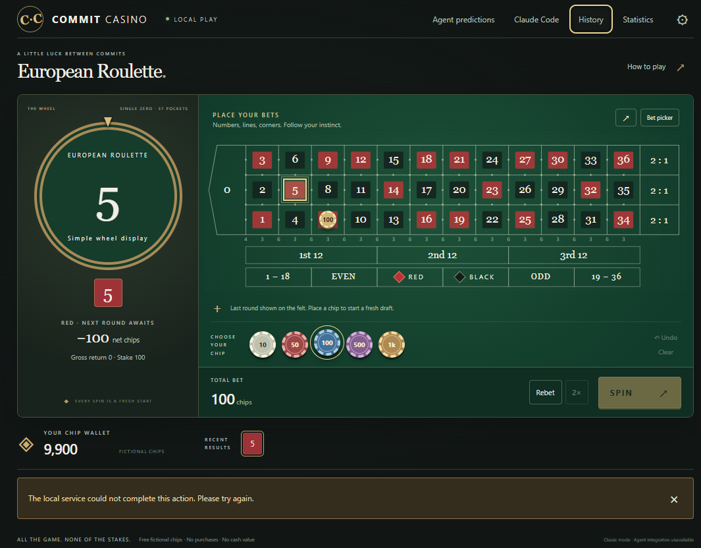

# Commit Casino

An offline European roulette game for developers. Play with free virtual chips;
there are no accounts, payments, telemetry, advertisements, or runtime AI calls.
Windows and the static browser edition use the same versioned 157-bet catalog.



Start with 10,000 chips. Place chips on the table or use the searchable keyboard
bet picker, then spin. Undo, Clear, Rebet, and Double work on the uncommitted
draft. The service records and debits a round before its wheel animation starts;
interruptions recover the recorded result and cannot produce a second payout.
Settings include sound, reduced motion, fast animation, and window modes.

## Install and play

Use the Windows x64 installer from [Releases](https://github.com/ndunl075/commit-casino/releases).
The installer includes the offline WebView2 prerequisite and helper. Installed
gameplay needs no Node, Rust, Claude, internet connection, or developer tools.
Packages are unsigned: Windows may show an unknown-publisher warning. Verify
the downloaded file against the release's `SHA256SUMS.txt`.

The browser ZIP contains static files. Serve its contents over HTTPS or localhost;
after one successful load, the service worker supports offline reloads. A
`file://` double-click does not provide supported offline installation. Browser
and Windows wallets are independent. If persistent browser storage is denied,
explicit temporary play is available and clearly labeled.

All chips are virtual. A winning number bet returns 36 times its stake including
the original stake; other payouts appear in the picker. Zero loses outside bets.
Refill/reset and history controls are local, with pending-wager restrictions.

## Optional Claude integration

Windows Settings offers an explicit preview before connecting Claude Code.
Classic works without this connection. The compiled helper writes only bounded,
signed lifecycle observations to a private local inbox. It strips prompts,
responses, tool arguments, source and transcript paths before writing. It never
approves permissions or sends agent context. Existing hooks are preserved;
disconnect removes only owned entries. Auto-open is separately opt-in and does
not steal focus. See [integration setup](crates/hook-bridge/README.md).

Agent Roulette predicts the next eligible observed turn using explicitly
registered verification suites and fixed 1:1 category odds. Unknown evidence,
unsupported observations, canceled checks, missing boundaries and timeouts
refund the stake. These labels describe observed checks, not task correctness.
See the [architecture and evidence policy](ARCHITECTURE.md).

## Develop

Tested with Node 22.23.2 and Rust 1.99 MSVC on Windows x64. Use Node 22.12+,
stable Rust, Visual Studio C++ Build Tools, Windows SDK, and WebView2. Browser
development requires Node only. No paid service or signing certificate is needed.

```sh
npm ci
npm run dev:web
npm run dev:desktop
npm run lint
npm run typecheck
npm test
npm run test:contracts
npm run test:e2e
npm run test:ui
npm run test:native
npm run lint:native
npm run build:web
npm run build:desktop
npm run test:desktop
# Rebuild the default release after the isolated smoke-feature executable:
npm run build:desktop
npm run package:release
```

Install browser test dependencies with `npx playwright install chromium`.
`build:desktop` compiles the Rust helper, bundles UI and license notices, and
creates the offline NSIS installer. Dependency downloads occur at build time.
The test-only `native-smoke` Cargo feature redirects storage to an isolated
workspace directory; the default release does not honor that override.

## Local data and uninstall

Windows stores its SQLite wallet/history under
`%APPDATA%\dev.commitcasino.desktop`; browser data belongs to its origin. Quit
before backing up the entire native data directory. Uninstall through Windows
Installed Apps or the installed uninstaller. Disconnect the optional hooks first;
uninstall preserves wallet data. Delete that data directory manually only when
you intend to erase your wallet and history. Clearing visible history preserves
the ledger needed for idempotency and reconciliation.

MIT licensed. Dependency notices ship with each installer and in a separate
license archive. See [notices](THIRD_PARTY_NOTICES.md),
[contributing](CONTRIBUTING.md), and [acceptance record](docs/IMPLEMENTATION.md).
macOS/Linux installers are not advertised without platform installation tests.
